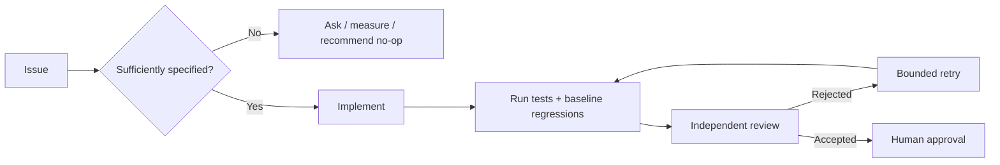

# Factory AI Droid evaluation — CSEE Code Factory

**Six-issue, evidence-based assessment of Factory AI against Khiem Nguyen's Warp Factories benchmark**  
**Experiment:** 8–9 November 2026 · **Report:** 9 November 2026 · **Status:** case study, not a controlled provider ranking

> **Result in brief:** Factory AI Droid produced a PR for each of the six tasks; four initially met the benchmark rubric, one required corrective human feedback, and one implemented an unmeasured optimization without clarifying an intentionally vague request. Warp's original published evaluation rated six of six first responses rubric-aligned, including a justified clarification/no-op workflow on the ambiguous performance task. This is a *workflow observation*, not a claim that one provider or model is universally better.

## At a glance

| Measure | Factory AI Droid (this evaluation) | Warp Factories (Khiem's published run) |
|:--|:--|:--|
| Benchmark issues assessed | 6 | 6 |
| Rubric-aligned first handling | **4/6** | **6/6** (includes asking on #6) |
| Eventual rubric-aligned outcomes | **5/6, provisional** | **6/6, author-reported** |
| Corrective human feedback | **1 round** (Issue #5) | No *corrective* user rounds recorded; #6 required one scope answer |
| Pull requests | **6** | **4** covering tasks #1–5; no PR on #6 |
| Tokens reported | **3,017,684** across selected Factory runs | Not disclosed by issue |
| Cost as reported | **$0.00 OpenRouter free-model API charges** | **$11.26 Warp-reported charges** |
| End-to-end speed comparison | **Not valid**: Factory active-session seconds vs Warp partial time-to-PR | Not the same measurement |

**Important:** These figures represent different model configurations, orchestration systems, instrumentation and pricing boundaries. Factory used **Droid** and a free OpenRouter NVIDIA Nemotron model; it did **not** demonstrate Factory Missions. Neither $0.00 nor six PRs means six autonomous, validated successes.

## Explore the evidence

| Where to start | What you will find |
|---|---|
| **[Full technical comparison](docs/factory-vs-warp.md)** | Detailed correctness, autonomy, tests, model/cost caveats, issue-level technical review and CSEE implications |
| **[Per-issue evaluation](eval/README.md)** | Six short case files linking Factory PRs, underlying diffs and corresponding Warp benchmark issues |
| **[Scorecard](eval/scorecard.csv)** | Machine-readable initial/final rubric outcomes and intervention labels |
| **[Usage dataset](data/factory-usage-by-issue.csv)** | Six actual reported token aggregates, exact available splits and provenance markers |
| **[Methodology and limitations](eval/methodology.md)** | Definition of success, exclusion rules, how time/cost are interpreted |
| **[Evidence index](evidence/README.md)** | Sanitized code diffs supplied for PRs #8–12; #1 diff unavailable |
| **[Verification script](scripts/validate_results.py)** | Checks consistency of public aggregate dataset, scorecard and provided diff filenames |
| **[Architecture implications](docs/code-factory-recommendations.md)** | Concrete Refine → Implement → Validate → Review → Retry gates |

### Issues and outcomes

| Issue | Factory's *first handling* | Factory *eventual outcome* | Main observation |
|:--|:--|:--|:--|
| [#1 Docs](eval/issues/01-documentation.md) | Aligned, provisional | Aligned, provisional | Documentation scope respected; original diff unavailable |
| [#2 Pagination](eval/issues/02-pagination.md) | Aligned | Aligned | Root cause fixed; basic regression tests |
| [#3 Slugify](eval/issues/03-slugify.md) | Aligned | Aligned | Normalization implemented; Unicode edges remain |
| [#4 Filter](eval/issues/04-filter.md) | Aligned | Aligned | Functionality present; test isolation weak |
| [#5 Timestamps](eval/issues/05-timestamps.md) | **Not aligned** | **Aligned after feedback** | First patch incorrect; one human repair cycle |
| [#6 Performance](eval/issues/06-performance.md) | **Not aligned** | **Not aligned to ambiguity rubric** | Optimization PR, but no question or performance baseline |

## Relationship to the original benchmark

- **Original benchmark and Warp evaluation:** [HawKhiem/warp-factory-sandbox](https://github.com/HawKhiem/warp-factory-sandbox) — benchmark design, test application, runbook, answer key and Warp scorecard are Khiem Nguyen's work. This repository does **not** claim to reproduce or re-run Warp.
- **Factory agent's implementation PRs:** [Factory experiment code repository](https://github.com/anushree-goyal/factory-sandbox-factory) (private at evaluation time; access to linked PRs may need permission).
- **This repository:** Factory results, evidence review and cross-workflow comparison compiled for the CSEE Code Factory project.

## Reproducibility and privacy

Run `python3 scripts/validate_results.py` to check that the **published aggregates and scorecard** are internally consistent. This is **not** a replay of provider calls or the complete Node.js test suite. The original request-level OpenRouter exports, Factory session IDs, dashboard screenshot and source attribution script are deliberately **not included in this publication-oriented edition**. Their checked source hashes and limitations are discussed in [data provenance](eval/data-provenance.md). The complete raw evidence package should be retained separately for authorized CSEE reviewers.

**Attribution:** Six-issue task design, sandbox, Warp benchmark and original evaluation by [Khiem Nguyen](https://github.com/HawKhiem); Factory Droid experiments and comparative analysis performed for CSEE Code Factory. Product-specific behavior described here is limited to these observed configurations and dates.
