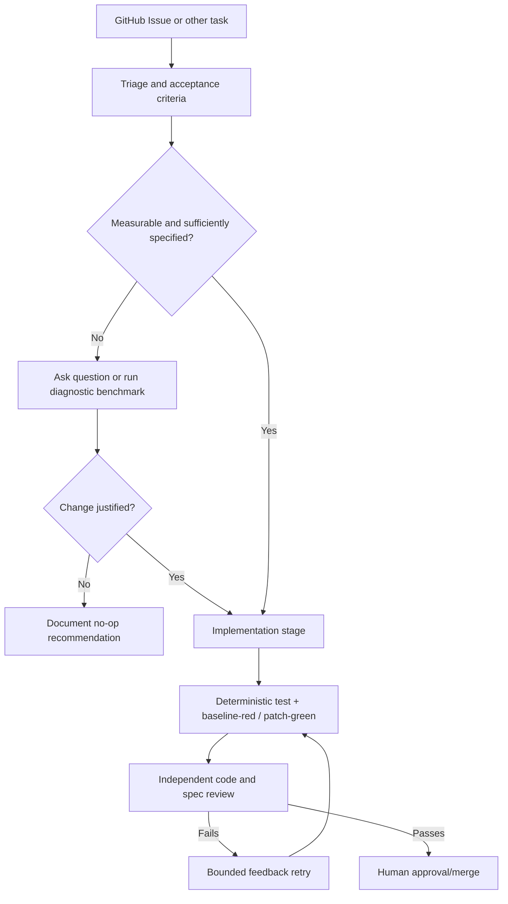

# Implications for CSEE Code Factory

The six tasks suggest that task refinement and validation gates matter more than counting generated PRs. This is a **small qualitative case study**, not a validated production architecture.

## Proposed MVP path

**Priorities:**

1. **Refine gate:** explicitly handle underspecified goals, especially performance requests, with quantifiable workloads, baselines and stop criteria (Issue #6).
2. **Independent validation:** require bug-catching regression tests, not only green tests; freeze clocks for timing properties and stress or microbenchmark real performance claims (#2, #4–6).
3. **Review + repair:** separate first-attempt metrics from eventual human-guided revisions; send a specific counterexample to a bounded retry (#5).
4. **No-op as a valid result:** outcome states should include `needs_clarification`, `diagnostic_completed`, `no_change_recommended`, `pr_ready`, `retry_required` and `escalated`.
5. **Observability:** pin repo baseline, prompt, harness/model, end-to-end time, active time, input/output/cache tokens, billed cost scope, test reports, reviewer actions and feedback rounds.
6. **Controlled follow-up:** separately compare Factory Droid, Factory Missions and Warp under shared test rubrics and repeated trials; do not equate this Droid run with Missions functionality.

For discussion of evidence and limitations, see the [complete report](factory-vs-warp.md).
